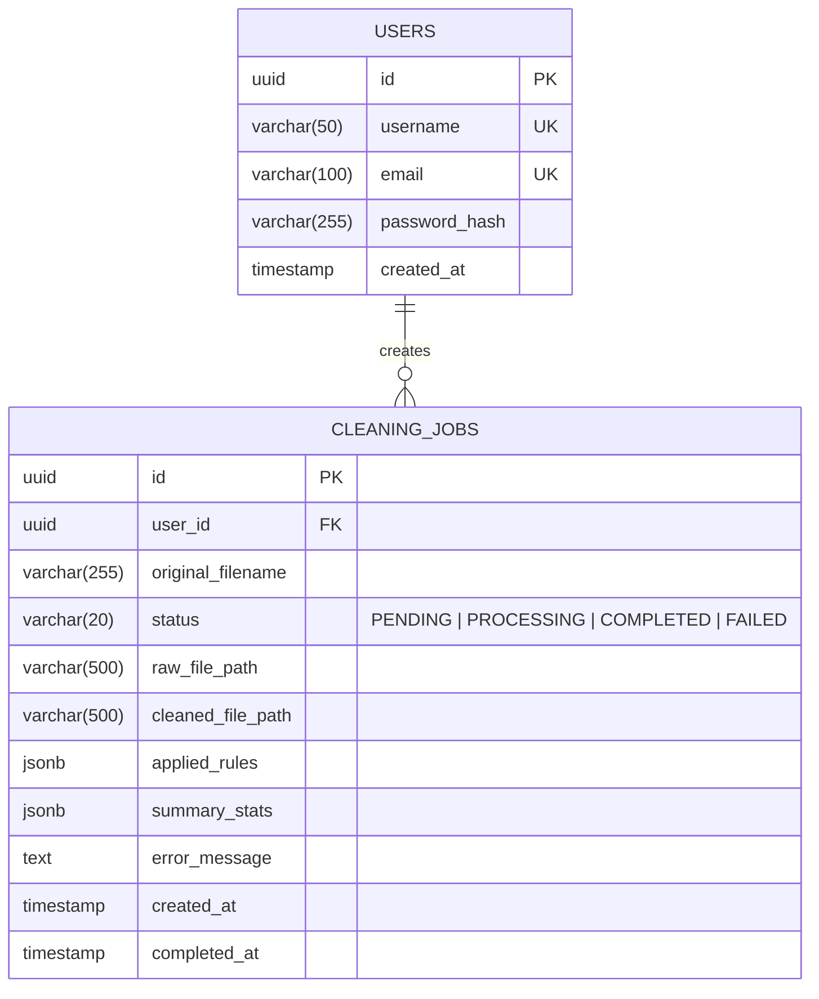

# Alt Düzey Sistem Tasarımı (LLD - Low-Level Design)
**Proje:** DataScrub Platformu  
**Kapsam:** Veritabanı Şeması, Servisler Arası API Kontratları ve Klasör Yapısı

---

## 1. Veritabanı Tasarımı (PostgreSQL ER Diyagramı)

Spring Boot servisi tarafından yönetilecek ilişkisel veritabanı şemasıdır. Esnek temizlik kuralları ve rapor istatistikleri PostgreSQL'in `JSONB` veri tipinde saklanır.



---

## 2. API Kontratları (Endpoints & JSON Şemaları)

### 2.1. Dış API: React $\rightarrow$ Spring Boot (`:8080`)

#### **A. Dosya Yükleme ve Temizleme Başlatma**
* **Endpoint:** `POST /api/v1/jobs/clean`
* **Content-Type:** `multipart/form-data`
* **Form Parametreleri:**
  * `file`: `.csv` dosyası (Binary)
  * `rules`: Aşağıdaki JSON formatında string:
```json
{
  "customNaValues": ["ERROR", "UNKNOWN", "N/A"],
  "dropDuplicates": true,
  "numericFillStrategy": "median",
  "categoricalFillValue": "Unknown",
  "stripCurrencySymbols": [" TL", "$", "€"],
  "standardizeDates": true
}
```
* **Başarılı Yanıt (`200 OK`):**
```json
{
  "jobId": "550e8400-e29b-41d4-a716-446655440000",
  "status": "COMPLETED",
  "originalFilename": "dirty_cafe_sales.csv",
  "summaryStats": {
    "rowsBefore": 10000,
    "rowsAfter": 9517,
    "duplicatesRemoved": 0,
    "missingValuesFilled": 8150,
    "processingTimeMs": 142
  },
  "downloadUrl": "/api/v1/jobs/550e8400-e29b-41d4-a716-446655440000/download"
}
```

#### **B. Temizlenmiş Dosyayı İndirme**
* **Endpoint:** `GET /api/v1/jobs/{jobId}/download`
* **Yanıt:** `200 OK` (`Content-Type: text/csv`, `Content-Disposition: attachment; filename="cleaned_dirty_cafe_sales.csv"`)

---

### 2.2. Dahili API: Spring Boot $\rightarrow$ Python FastAPI (`:8000`)

Bu endpoint yalnızca Docker iç ağından erişilebilirdir.

* **Endpoint:** `POST /internal/v1/process`
* **Content-Type:** `application/json`
* **Request Body:**
```json
{
  "jobId": "550e8400-e29b-41d4-a716-446655440000",
  "inputFilePath": "/storage/raw/550e8400_dirty_cafe_sales.csv",
  "outputFilePath": "/storage/cleaned/550e8400_cleaned.csv",
  "rules": {
    "customNaValues": ["ERROR", "UNKNOWN", "N/A"],
    "dropDuplicates": true,
    "numericFillStrategy": "median",
    "categoricalFillValue": "Unknown",
    "stripCurrencySymbols": [" TL", "$", "€"],
    "standardizeDates": true
  }
}
```
* **Response Body (`200 OK`):**
```json
{
  "success": true,
  "outputFilePath": "/storage/cleaned/550e8400_cleaned.csv",
  "stats": {
    "rowsBefore": 10000,
    "rowsAfter": 9517,
    "columnsCount": 8,
    "duplicatesRemoved": 0,
    "missingValuesBefore": 7087,
    "missingValuesAfter": 0,
    "processingTimeMs": 142
  },
  "previewRows": [
    {"Transaction ID": "TXN_1961373", "Item": "Coffee", "Quantity": 2, "Total Spent": 4.0}
  ]
}
```

---

## 3. Monorepo Klasör Yapısı

Tüm servisler tek bir ana depo (Monorepo) altında standartlaştırılmış şekilde tutulacaktır:

```text
datascrub-platform/
├── docs/                       # Mimari ve gereksinim dokümanları (SRS, HLD, LLD)
├── engine-python/              # Python FastAPI + Pandas/NumPy Veri Motoru
│   ├── app/
│   │   ├── main.py             # FastAPI endpoint tanımları
│   │   ├── cleaner.py          # Pandas & NumPy temizlik algoritmaları
│   │   └── schemas.py          # Pydantic istek/yanıt modelleri
│   ├── tests/
│   │   └── test_cleaner.py     # Pytest birim ve entegrasyon testleri
│   ├── Dockerfile
│   └── requirements.txt
├── backend-spring/             # Java Spring Boot Core Servisi
│   ├── src/main/java/com/datascrub/
│   │   ├── controller/         # REST API uçları
│   │   ├── service/            # İş mantığı ve FastAPI istemcisi
│   │   ├── repository/         # Spring Data JPA arayüzleri
│   │   └── model/              # Entity ve DTO sınıfları
│   ├── src/test/java/          # JUnit 5 & Mockito testleri
│   ├── Dockerfile
│   └── pom.xml
├── frontend-react/             # React + TypeScript Kullanıcı Arayüzü
│   ├── src/
│   ├── Dockerfile
│   └── package.json
├── storage/                    # Paylaşımlı geçici dosya alanı (.gitignore'a eklenecek)
├── docker-compose.yml          # Tüm sistemi tek komutla ayağa kaldıran yapı
└── README.md                   # Proje vitrini ve kurulum rehberi
```
